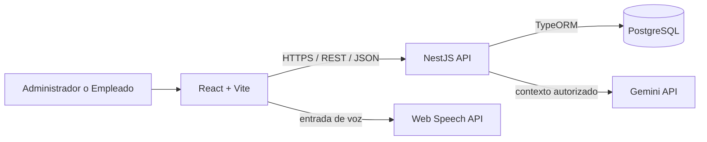
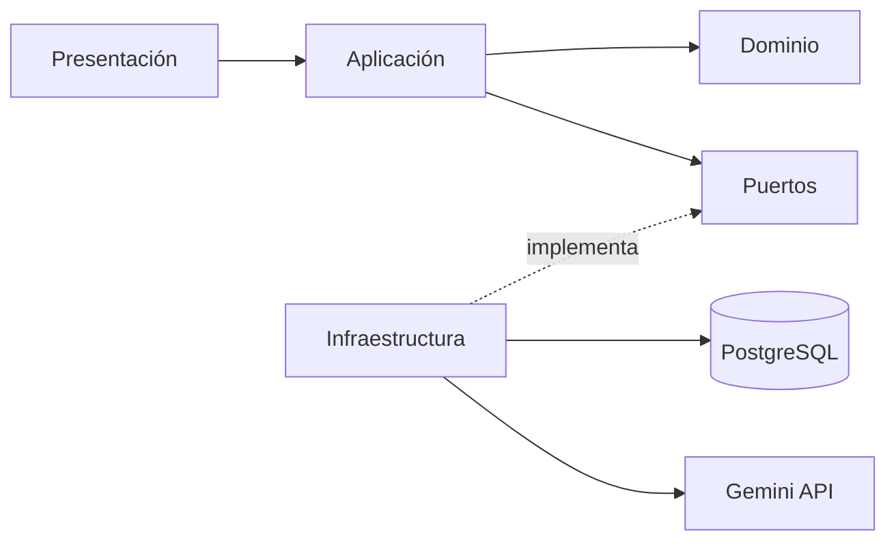
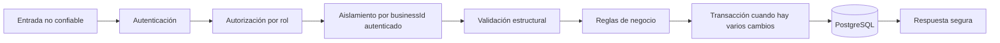
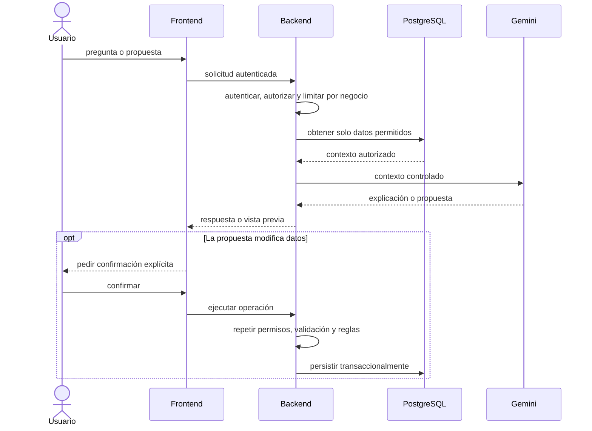

# Arquitectura de Pulso

> Estado del documento: base técnica implementada; funcionalidades de negocio pendientes.
> Verificado el 14 de octubre de 2026 en `feature/project-foundation` y contra la Wiki (`e8b2c90`).

## 1. Alcance y fuentes de verdad

Pulso es una aplicación web para pequeños negocios de alimentos, inicialmente cafés y negocios similares de Bolivia. Su objetivo es relacionar ingredientes, compras, recetas, productos, ventas e inventario para calcular costos y márgenes y explicar por qué cambian.

Este documento consolida la arquitectura descrita en la [Wiki del proyecto](https://github.com/Fernanda-Escobar-Fullstack/pulso/wiki) y la contrasta con el repositorio. La prioridad de las fuentes es:

1. código, migraciones, pruebas y configuración ejecutables;
2. decisiones aceptadas y requisitos de la Wiki;
3. este documento como resumen versionado de la arquitectura objetivo.

Si una fuente de mayor prioridad contradice a una inferior, la diferencia debe documentarse y resolverse; no se debe adaptar silenciosamente el código ni la documentación.

### Estado verificable actual

El repositorio implementa la primera base ejecutable:

- `frontend/` contiene una aplicación React/Vite mínima, una prueba de renderizado y configuración de ESLint, Prettier y Vitest;
- `backend/` contiene una API NestJS con `/api/v1/health`, configuración validada, CORS, validación global y conexión PostgreSQL mediante TypeORM;
- `.github/workflows/ci.yml` ejecuta formato, lint, pruebas y build para ambas aplicaciones;
- los lockfiles permiten instalaciones reproducibles con npm y Node.js 24 LTS.

Todavía no existen módulos de negocio, entidades, migraciones, autenticación, autorización, IA, observabilidad de producción, pruebas E2E ni despliegues. Esas secciones continúan describiendo arquitectura objetivo.

## 2. Visión general

La arquitectura objetivo es un monorepositorio con dos aplicaciones separadas y un único backend modular. No se planifican microservicios para el MVP.



El backend es el límite de confianza: autentica, autoriza, aplica aislamiento por negocio, valida entradas, ejecuta reglas deterministas y controla el acceso a PostgreSQL y Gemini. La interfaz nunca concede permisos ni se convierte en fuente de verdad.

## 3. Stack tecnológico documentado

| Área                | Decisión objetivo                                       | Estado verificable                                      |
| ------------------- | ------------------------------------------------------- | ------------------------------------------------------- |
| Runtime y gestor    | Node.js + npm                                           | Node.js 24 LTS; npm 11                                  |
| Lenguaje            | TypeScript en frontend y backend                        | 6.0.3                                                   |
| Frontend            | React + Vite                                            | React 19.3.0; Vite 8.3.4                                |
| UI                  | Tailwind CSS                                            | Planificado                                             |
| Backend             | NestJS                                                  | 12.1.3                                                  |
| API                 | REST, JSON, `/api/v1`                                   | Base HTTP implementada; HTTPS corresponde al despliegue |
| Persistencia        | PostgreSQL mediante TypeORM                             | TypeORM 1.1.2 y `pg` 8.23.1; sin entidades aún          |
| Validación          | `class-validator` + `class-transformer`                 | Instalados; `ValidationPipe` global configurado         |
| Autenticación       | JWT, email/contraseña y Google OAuth                    | Planificado                                             |
| Hash de contraseñas | bcrypt                                                  | Planificado                                             |
| IA                  | Gemini API, siempre mediada por el backend              | Planificado                                             |
| Voz                 | Web Speech API en el navegador                          | Planificado                                             |
| Pruebas             | Vitest + Testing Library; Cypress previsto para E2E     | Unitarias base implementadas; E2E pendiente             |
| Calidad             | ESLint + Prettier                                       | Configurados en ambas aplicaciones                      |
| CI/CD               | GitHub Actions                                          | Workflow de calidad implementado; despliegue pendiente  |
| Hosting             | Cloudflare Pages, hosting Node.js y Supabase PostgreSQL | Objetivo; proveedor de backend sin elegir               |

Las versiones verificadas proceden de los manifiestos y lockfiles de cada aplicación.

## 4. Estilo arquitectónico y dependencias

### 4.1 Frontend

La Wiki propone tres responsabilidades:

- **Presentación:** páginas, componentes, formularios, estados de carga, vacío y error.
- **Lógica de aplicación:** coordinación de flujos de interfaz, confirmaciones y estado de cada feature.
- **Acceso a API:** comunicación tipada con el backend; no contiene reglas autoritativas.

La organización objetivo agrupa funcionalidad de dominio en `frontend/src/features/` y reserva `components/` para elementos visuales compartidos. `services/`, `hooks/`, `types/`, `utils/` y `styles/` alojan responsabilidades transversales claramente justificadas.

### 4.2 Backend

Las capas objetivo son:

| Capa               | Responsabilidad                                                       | No debe hacer                                                             |
| ------------------ | --------------------------------------------------------------------- | ------------------------------------------------------------------------- |
| Presentación / API | Rutas, DTOs, autenticación de solicitud, serialización y códigos HTTP | Ejecutar cálculos de negocio o consultar repositorios directamente        |
| Aplicación         | Coordinar casos de uso, permisos, transacciones y puertos             | Depender de detalles del framework en la lógica de negocio                |
| Dominio            | Reglas, estados, cálculos deterministas y errores de negocio          | Importar TypeORM, NestJS, HTTP, Gemini o configuración de infraestructura |
| Infraestructura    | Repositorios TypeORM, PostgreSQL, proveedores externos y adaptadores  | Decidir permisos o duplicar reglas del dominio                            |

La dependencia normativa se interpreta así:



El dominio no debe depender de infraestructura. Esta interpretación coincide con el texto de las decisiones técnicas, aunque uno de sus diagramas muestra `Domain → Infrastructure`; esa contradicción permanece abierta y se detalla en la sección 17.

### 4.3 Organización objetivo del repositorio

```text
pulso/
├── frontend/
│   └── src/
│       ├── components/
│       ├── features/
│       ├── pages/
│       ├── services/
│       ├── hooks/
│       ├── types/
│       ├── utils/
│       └── styles/
├── backend/
│   └── src/
│       ├── modules/
│       ├── common/
│       ├── config/
│       └── database/
├── docs/
└── .github/
    └── workflows/
```

Las carpetas raíz `frontend/`, `backend/`, `docs/` y `.github/workflows/` ya están implementadas. Las subdivisiones por feature y módulos se crearán únicamente al implementar cada capacidad. Cada módulo NestJS deberá mantener juntos su controlador, servicio, DTOs y código de dominio relacionado, sin convertir `common/` en un contenedor de lógica sin propietario.

## 5. Módulos funcionales y límites

El diseño objetivo contiene los siguientes módulos:

| Módulo                | Responsabilidad principal                                               |
| --------------------- | ----------------------------------------------------------------------- |
| Auth y usuarios       | Registro, login, Google OAuth, JWT, estado de usuario y roles           |
| Negocios              | Propiedad del tenant y aislamiento de todos los datos operativos        |
| Ingredientes          | Unidades, conversiones compatibles, costo de referencia y stock         |
| Recetas               | Composición, estados y costo calculado                                  |
| Productos             | Preparados o de reventa, precio, costo, utilidad y margen               |
| Proveedores y compras | Compras, ítems, historial, correcciones y actualización de stock/costos |
| Producción            | Consumo atómico de ingredientes y creación de stock preparado           |
| Turnos y ventas       | Apertura/cierre, ventas, ítems, snapshots históricos y stock            |
| Gastos                | Monto, categoría, fecha y control de información salarial               |
| Inventario y merma    | Conteos físicos, conciliación, discrepancias y reducciones confirmadas  |
| Alertas               | Cambios de costo, stock mínimo e inconsistencias de inventario          |
| Resultados            | Ingresos, gastos y resultados autorizados calculados por backend        |
| IA                    | Preguntas y propuestas usando únicamente contexto autorizado            |

Los módulos pueden colaborar mediante casos de uso y contratos explícitos. No deben leer tablas ajenas ni replicar cálculos para evitar sus límites públicos.

## 6. Flujo de ejecución y datos

Toda mutación normal debe seguir este orden lógico:



El `businessId` usado para consultar o mutar datos procede de la identidad autenticada, nunca de un valor confiado del cliente. Los identificadores enviados por el cliente deben resolverse dentro del mismo negocio.

Compras, producción, ventas, conteos y mermas afectan información histórica o stock. Cuando una operación realiza varios cambios relacionados, todos deben confirmar o revertirse juntos. En particular:

- una compra guarda cabecera e ítems, actualiza stock y puede crear una alerta;
- una producción consume ingredientes, guarda consumos y aumenta producto preparado;
- una venta guarda venta e ítems con snapshots de precio/costo y reduce stock;
- una conciliación conserva el conteo y la diferencia antes de actualizar el stock;
- una corrección preserva el registro original y su trazabilidad.

## 7. Reglas de negocio arquitectónicamente críticas

Las reglas completas se mantienen en la Wiki con identificadores `BR-001` a `BR-030`. Las que definen límites del sistema son:

- cantidades mayores que cero; precios mayores o iguales a cero;
- solo se convierten `kg ↔ g` y `L ↔ ml`; las unidades no se convierten a peso o volumen;
- una receta pasa por `Draft → Active → Archived`; una receta activa requiere ingredientes válidos;
- un producto preparado requiere receta activa; registros archivados no entran en operaciones nuevas;
- los movimientos reales no aceptan fechas futuras;
- una venta exige turno abierto y cada usuario tiene como máximo uno;
- el costo de receta, costo unitario, utilidad y margen se calculan en backend determinista;
- solo el Administrador decide si un precio de compra actualiza el costo de referencia;
- una compra excepcional queda en el historial sin cambiar el costo de referencia;
- ventas históricas conservan precio y costo aplicados;
- registros con uso histórico se archivan, no se eliminan;
- solo el Administrador accede a salarios y datos financieros restringidos;
- las acciones interpretadas por IA o voz requieren confirmación y vuelven a pasar por todas las validaciones.

## 8. Autenticación, autorización y multitenencia

Pulso documenta dos roles:

- **Administrador:** administra empleados, catálogo, recetas, productos, costos de referencia e información financiera privada.
- **Empleado:** registra las operaciones diarias que tenga permitidas.

Email/contraseña y Google verifican identidad; Pulso sigue siendo responsable de roles, estado de usuario, pertenencia al negocio y autorización. Las contraseñas deben almacenarse con bcrypt. Los JWT deben tener vida limitada y un token inválido o expirado produce `401`.

Cada registro de negocio debe contener `business_id`. Toda consulta, actualización y relación debe quedar limitada al negocio del usuario autenticado, incluida la carga previa de entidades. No basta con filtrar listados; también deben protegerse accesos por UUID, relaciones, agregados, alertas, IA y mensajes de error.

## 9. Persistencia y modelo de datos objetivo

El modelo documentado incluye `Business`, `User`, `Supplier`, `Ingredient`, `Recipe`, `RecipeIngredient`, `Product`, `Purchase`, `PurchaseItem`, `PurchaseCorrection`, `Production`, `ProductionConsumption`, `Shift`, `Sale`, `SaleItem`, `Expense`, `InventoryCount`, `Waste` y `Alert`.

Reglas de persistencia propuestas:

- claves primarias UUID;
- `business_id` en todos los registros operativos;
- claves foráneas, campos obligatorios, unicidad y restricciones simples en PostgreSQL;
- índices en `business_id`, claves foráneas y fechas usadas en consultas reales;
- un ítem de compra referencia un ingrediente o un producto de reventa, nunca ambos;
- un producto preparado referencia receta; uno de reventa no la necesita;
- los valores históricos no se recalculan retroactivamente;
- migraciones versionadas deben acompañar todo cambio de esquema.

El diagrama completo es todavía un borrador conceptual. No hay entidades ni migraciones implementadas para comprobar nombres, cardinalidades, nulabilidad o estrategia de borrado lógico.

## 10. Contrato HTTP objetivo

La API se documenta bajo `/api/v1`, con JSON, campos `camelCase`, UUID e ISO 8601. Los recursos previstos son `auth`, `users`, `ingredients`, `recipes`, `products`, `purchases`, `productions`, `sales`, `shifts`, `expenses`, `inventory`, `waste`, `alerts` y `ai`.

Los errores deben tener una forma estable, por ejemplo:

```json
{
  "statusCode": 409,
  "code": "INSUFFICIENT_STOCK",
  "message": "The operation would result in negative stock.",
  "details": null,
  "timestamp": "...",
  "path": "/api/v1/..."
}
```

Los controladores no deben repetir el mapeo de errores. Los errores esperados usan códigos de dominio estables; los inesperados se registran internamente y devuelven un mensaje genérico sin stack, consulta ni detalle de infraestructura.

## 11. IA y voz

Gemini es un proveedor auxiliar, no una capa de cálculo ni persistencia:



Gemini nunca recibe credenciales de base de datos, acceso SQL irrestricto ni datos que el usuario no puede ver. No genera los valores financieros oficiales. Un chat nuevo comienza sin historial persistido. Si Gemini o Web Speech falla, los formularios y funciones principales continúan disponibles.

## 12. Errores y observabilidad

El MVP plantea logs de aplicación simples y estructurados para login, mutaciones importantes, fallos de permisos útiles, fallos de Gemini y excepciones inesperadas. Un evento debería incluir nombre estable, nivel, timestamp e identificadores mínimos como `businessId`, `userId` y el ID de la operación.

Nunca deben registrarse contraseñas, hashes, JWT, tokens de Google, cabeceras de autorización, credenciales de base de datos, secretos, claves de Gemini, cuerpos completos ni datos financieros innecesarios. Los mensajes al usuario y el detalle técnico del log deben estar separados.

No se ha seleccionado un servicio de monitoreo, trazas o métricas. Los logs del backend y del hosting son la solución inicial documentada.

## 13. Seguridad

Los controles obligatorios derivados del diseño son:

- denegar por defecto rutas y acciones que requieran autenticación o roles;
- obtener tenant y permisos desde el contexto autenticado;
- validar DTOs con lista explícita de campos y rechazar propiedades inesperadas;
- parametrizar todo acceso a datos mediante el ORM y evitar SQL construido con entrada del usuario;
- configurar CORS solo para orígenes esperados, sin tratarlo como control de autorización;
- mantener secretos únicamente en configuración de servidor;
- no usar prefijos `VITE_` para secretos, porque se incorporan al bundle público;
- aplicar límites de solicitud especialmente a login e integración de IA;
- minimizar el contexto enviado a Gemini y resistir instrucciones que intenten saltar permisos;
- conservar trazabilidad y atomicidad en operaciones financieras y de inventario;
- no admitir uploads en V1 ni agregar ese perímetro sin una decisión explícita.

La política de revocación de JWT, almacenamiento del token en el navegador, protección CSRF, límites concretos y requisitos de contraseña aún no están decididos; no deben inventarse durante la implementación.

## 14. Pruebas y validación

La estrategia planificada prioriza riesgos sobre una cifra de cobertura:

- **unitarias:** conversiones, costos, margen, precios, stock y reglas de turno;
- **backend/API:** transacciones completas, estados HTTP, formato de error, autenticación, rol y aislamiento entre negocios;
- **frontend:** formularios, carga/error, acciones protegidas y confirmación de IA/voz;
- **E2E con Cypress:** login-turno-venta, compra-stock, producción y conteo-conciliación.

Toda prueba multitenant crítica debe usar al menos dos negocios y demostrar que no se puede leer, modificar ni inferir información del otro. Los fallos de Gemini y voz deben probar degradación segura.

La implementación base usa Vitest en frontend y backend, junto con Testing Library para React. Cypress permanece planificado para los flujos E2E. No se puede afirmar que una prueba, lint o build pasa sin ejecutar el comando real del repositorio.

## 15. Despliegue y CI/CD objetivo

El objetivo es desplegar el frontend en Cloudflare Pages, la API NestJS en un proveedor Node.js aún no elegido y PostgreSQL en Supabase. Desarrollo, pruebas y producción usan configuración y datos separados.

GitHub Actions instala dependencias con `npm ci` y ejecuta formato, lint, pruebas y build de ambas aplicaciones en cada pull request dirigido a `main` y en cada push a `main`. Las protecciones de rama pueden exigir esos checks; una revisión de Copilot por sí sola no bloquea un merge.

Siguen pendientes el despliegue y los controles automáticos de secretos, dependencias y migraciones.

## 16. Decisiones y exclusiones del MVP

Decisiones aceptadas: React + Vite, NestJS, PostgreSQL, JWT + Google OAuth, monorepositorio, arquitectura por capas, REST y Gemini a través del backend.

Quedan fuera del MVP: microservicios, colas, WebSockets, almacenamiento de archivos, OCR, pagos o suscripciones, varias sucursales, modo offline, notificaciones externas y explicaciones automáticas no respaldadas por evidencia.

Añadir cualquiera de estas capacidades requiere actualizar requisitos, riesgos, límites y, cuando corresponda, registrar una nueva decisión arquitectónica.

## 17. Inconsistencias entre Wiki y repositorio

### 17.1 Documentación frente a implementación

La Wiki describe el sistema completo, mientras que el repositorio implementa solo la fundación. Los revisores deben distinguir la base verificada de los módulos de negocio todavía planificados.

La Wiki selecciona Jest como test runner; la base generada con las versiones actuales de Vite y NestJS usa Vitest para reducir configuración duplicada. Esta diferencia debe formalizarse en la Wiki si el equipo mantiene Vitest después de la primera revisión.

### 17.2 Dirección de dependencias

`System Architecture` muestra `Application → Domain` y `Application → Infrastructure`. El ADR-006 muestra `Presentation → Application → Domain → Infrastructure`, aunque su texto afirma que las reglas de negocio deben permanecer alejadas de base de datos y servicios externos. Este documento adopta dominio independiente e infraestructura implementando puertos; la Wiki debe corregirse o formalizar otra decisión antes de imponer imports concretos.

### 17.3 Ventas y stock negativo

`BR-009` permite vender cuando el stock registrado es cero porque el stock físico puede diferir. `Testing Strategy` propone una restricción de base de datos que impida stock almacenado negativo, y los flujos de venta indican que la venta reduce stock. Las tres afirmaciones no pueden cumplirse simultáneamente sin un mecanismo adicional de discrepancia o stock pendiente. La política de ventas con stock insuficiente debe resolverse antes de implementar el esquema y el caso de uso.

### 17.4 Detalles aún no definidos

- proveedor y configuración del backend;
- política de JWT, refresh/revocación y almacenamiento en cliente;
- límites concretos de rate limiting;
- esquema final, precisión de dinero y cantidades, zonas horarias y estrategia de concurrencia;
- fronteras exactas entre módulos y contratos de repositorio;
- umbral de “cambio relevante” para costos y alertas;
- catálogo de métodos de pago y categorías de gasto;
- nivel de accesibilidad verificable y estrategia de auditoría.

Estos puntos deben registrarse como decisiones o contratos antes de que una revisión los trate como requisitos.

## 18. Mantenimiento de este documento

Actualizar este archivo cuando se introduzca o cambie una frontera, dependencia, flujo, modelo, requisito de seguridad o decisión de despliegue. Cada afirmación técnica debe permanecer enlazada a evidencia ejecutable o marcarse como objetivo. La Wiki conserva el detalle de producto y reglas; este documento conserva la vista arquitectónica versionada junto al código.
